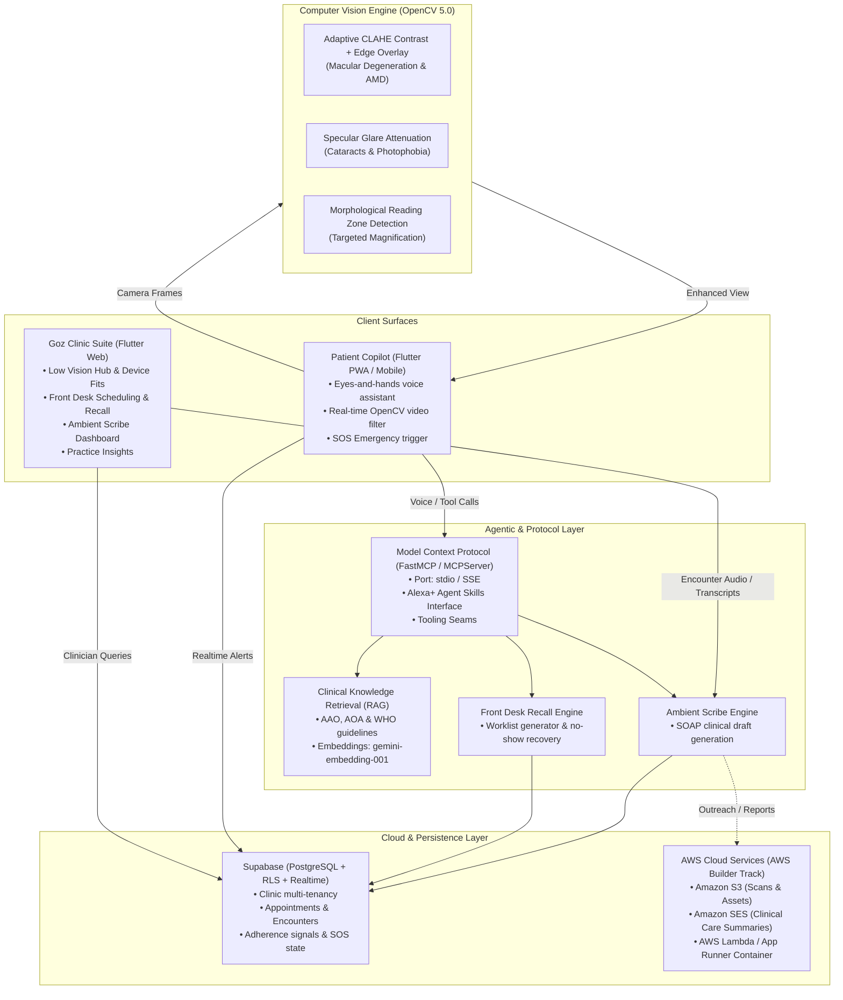

# GozVision Architecture & Hackathon Specification

GozVision is an assistive visual copilot and clinical workflow automation platform engineered for low-vision patients and eye care practices.

---

## Hackathon Track Alignments

### 1. Amazon Developer Hackathon: Build, Ship, Shape (Deadline: Oct 23, 2026)
* **Track:** **Alexa+ Track** (Agentic experiences, Agent Skills, and self-hosted MCP servers).
* **Mini-Challenges:** **AWS Builder** & **Open Source** challenges.
* **Component:** `backend/gozvision_mcp/server.py` exposing:
  - `clinical_knowledge_lookup`
  - `trigger_emergency_sos`
  - `front_desk_recall_sweep`
  - `draft_ambient_scribe_chart`
  - `cv_enhance_accessibility_frame`

### 2. OpenCV AI Competition 2026 (Deadline: Oct 26, 2026)
* **Track:** **Healthcare & Accessibility** and **Agentic Vision Award**.
* **Component:** `backend/gozvision_vision/cv_pipeline.py` implementing:
  - `enhanced_contrast`: LAB CLAHE + Canny morphological boundaries for AMD patients.
  - `glare_suppression`: Specular highlight attenuation for cataracts/photophobia.
  - `reading`: Text detection via morphological gradient bounding boxes.
