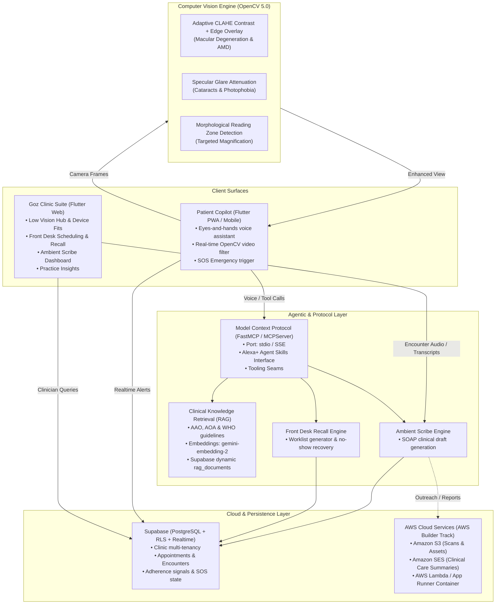

# GozVision Platform Architecture

GozVision is an enterprise-grade assistive visual copilot and clinical workflow automation platform engineered for eye care practices and patients across the full continuum of vision care.

---

## Core Platform Components

### 1. Dual-Mode Patient Experience (`apps/patient/`)
- **Low-Vision Assist Mode (`lowVisionAssist`)**: Voice-first, continuous edge-CV filtering, proactive obstacle haptics, hands-free operation.
- **Clinic Companion Mode (`clinicCompanion`)**: Visual-first UI, quiet on-demand assistant, medication/drop tracking, appointment scheduling, clinical Q&A.
- **Dynamic Profile Switching**: Hands-free voice tool call (`switchVisionProfile`) or visual profile switcher in Patient Profile screen.

### 2. Clinic Suite (`apps/clinic/`)
- **Low Vision Hub**: Manages referrals, device fittings, functional vision goals, and live adherence telemetry.
- **Front Desk Recall**: Automated scheduling recovery, no-show outreach, two-way SMS/WhatsApp conversational booking.
- **Ambient Scribe with Linked Evidence**: Generates structured SOAP drafts grounded directly in encounter audio, with 1-click transcript verification.
- **Doctor Clinical Copilot & Quick-Reference**: Real-time guideline lookup (AAO PPP, AOA, TFOS DEWS II, NEI), drug contraindication checks, and dynamic clinical RAG.

### 3. Edge Computer Vision Pipeline (`backend/gozvision_vision/cv_pipeline.py`)
- **Enhanced Contrast**: LAB CLAHE + Canny morphological boundaries for AMD and low contrast sensitivity.
- **Glare Suppression**: Specular highlight attenuation for cataracts and photophobia.
- **Reading Zone Detection**: Targeted text isolation and morphological gradient bounding boxes.
- **Smart Glasses Profile**: Lightweight, power-efficient streaming profile for Ray-Ban Meta and Rokid eyewear.

### 4. Agentic Model Context Protocol (`backend/gozvision_mcp/server.py`)
- Standardized MCP server exposing `clinical_knowledge_lookup`, `trigger_emergency_sos`, `front_desk_recall_sweep`, `draft_ambient_scribe_chart`, and `cv_enhance_accessibility_frame`.

### 5. Multi-Tier Clinical Knowledge Base (RAG)
- **Static Core Corpus**: Curated evidence-based guidelines from AAO, AOA, WHO, and peer-reviewed ophthalmic trials.
- **Dynamic PostgreSQL Store (`rag_documents`)**: Clinic-specific protocols and real-time guideline updates loaded without downtime.
- **Vector Embeddings**: Powered by `gemini-embedding-2` with SHA-256 fingerprint caching (`.embedding_cache.json`).
