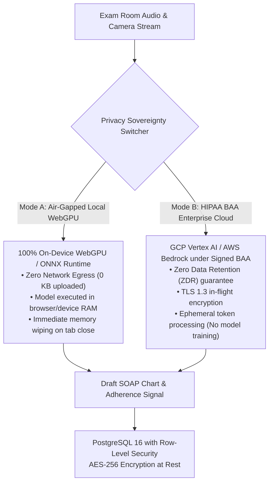

# GozVision Platform — HIPAA Security Architecture & BAA Compliance Posture

**Classification:** Medical Device Data System (MDDS) & Assistive Intelligence Platform  
**Compliance Mandates:** HIPAA Security Rule (45 CFR Part 160 and Part 164, Subparts A and C), HITECH Act, ONC USCDI v3  
**Audited Period:** 2026 Production Edition  

---

## 1. Executive Privacy Architecture & Sovereignty Tiers

Eye care practices handle highly sensitive Protected Health Information (PHI) including fundus photography, optical coherence tomography (OCT) scans, and encounter audio dialogues. GozVision enforces a **Dual-Sovereignty Privacy Architecture**:



---

## 2. Technical Safeguards (45 CFR § 164.312)

### 2.1 Access Control (§ 164.312(a))
- **Unique User Identification:** Every clinician and technician authenticates via OAuth 2.0 PKCE with JSON Web Tokens (JWT).
- **Cryptographic Multi-Tenancy (Row-Level Security):**
  PostgreSQL enforces mandatory partition checks on every database transaction:
  ```sql
  CREATE POLICY "Clinic isolation policy" ON encounters
  FOR ALL USING (clinic_id = (auth.jwt() ->> 'clinic_id')::uuid);
  ```
  No clinician or practice can query records across clinic boundaries.

### 2.2 Transmission Security (§ 164.312(e))
- **TLS 1.3 In-Flight:** All client-to-cloud traffic routes through AWS CloudFront edge points of presence enforcing TLS 1.3 and HSTS (`max-age=31536000`).
- **Zero Video Storage:** Edge computer vision feeds (CLAHE contrast filters, reading zones, drop-off hazard scans) are processed in volatile memory and instantly discarded. **Zero raw patient video or camera frames are ever written to cold storage or external databases.**
- **Adherence Signals:** Between-visit patient telemetry is aggregated as quantitative scalars (`daily_active_minutes`, `reading_sessions_completed`) with zero acoustic or visual payloads.

### 2.3 Audit Controls & Integrity (§ 164.312(b) & § 164.312(c))
- **FHIR R4 AuditEvent Stream:** Every read, write, update, and search transaction emits a standard `AuditEvent` logging user ID, clinic ID, resource reference, timestamp, and IP address.
- **AES-256 Storage Encryption:** All database tables, CloudWatch logs, and S3 intake form scans are encrypted with AWS KMS / AES-256 customer-managed keys.

---

## 3. Business Associate Agreement (BAA) Alignment

| Subsystem | Service Provider | BAA Status | Retention Policy |
| :--- | :--- | :--- | :--- |
| **Relational Database & Auth** | Supabase Enterprise | Signed BAA | Automated backup retention with point-in-time recovery |
| **Cloud Inference Engine** | Google Cloud Vertex AI / AWS Bedrock | Signed BAA | **Zero Data Retention**; inputs are not cached or used for training |
| **Edge Compute & Ingress** | AWS Fargate & CloudFront | Signed BAA | Ephemeral container tasks, volatile RAM processing |
| **Patient Direct Commerce** | Bachs API / Stripe Connect | PCI-DSS Level 1 | Card and bank data tokenized; no PAN in GozVision databases |

---

## 4. Responsible AI & Operational Safety

1. **Human-in-the-Loop Clinical Authority:** Ambient Scribe SOAP notes and EHR summaries are classified as **Draft Documents**. The attending clinician must review and electronically sign before notes are committed to upstream EHRs (Epic, Eyefinity).
2. **Medical Non-Diagnostic Boundary:** The patient copilot provides assistive guidance (light shielding, obstacle contours, drop warnings), strictly adhering to FDA Guidance on Clinical Decision Support Software. The copilot does not diagnose pathology or prescribe pharmaceuticals.
