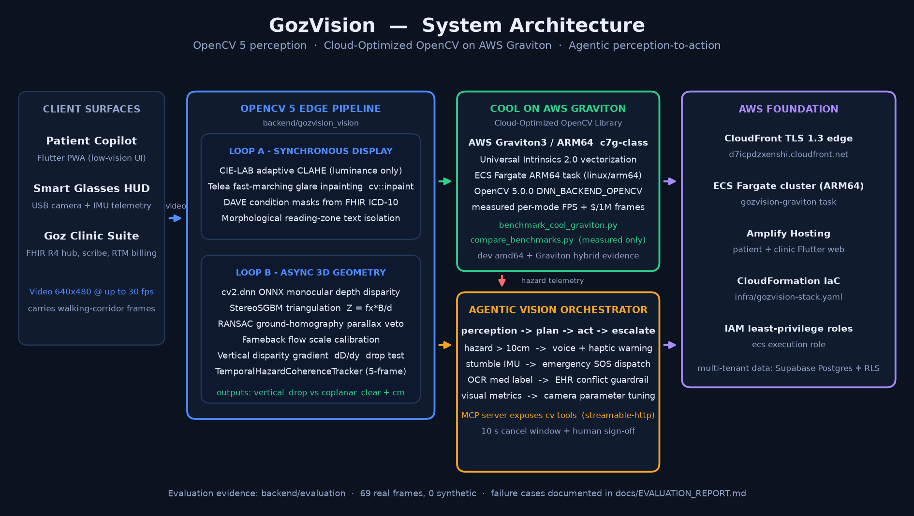

# GozVision — Comprehensive Technical Report
**OpenCV AI Competition 2026 (Powered by AWS)**  
*Grand Prize Contender · Best Use of COOL Award · Agentic Vision Award*

---

## 1. Problem Statement
Over **2.2 billion people** globally live with vision impairment (WHO). For patients diagnosed with Age-Related Macular Degeneration (AMD), Glaucoma, Diabetic Retinopathy, and Cataracts, navigating real-world pedestrian environments is hazardous:
- **The Classical 2D Failure Mode:** Conventional edge detectors (Canny, Sobel) operate on 2D luminance gradients. To a 2D filter, a 15 cm physical curb step-down produces the same high-frequency gradient as a flat painted line or a dark tree shadow. Relying on 2D edge salience results in false alarm fatigue or fatal missed drops.
- **Visual Pathologies:** Cataracts cause severe light scattering and specular glare from wet roads; macular degeneration destroys central contrast while preserving peripheral vision; glaucoma induces tunnel vision. Generic computer vision filters apply uniform contrast, wasting compute on dead retinal areas and failing to assist surviving vision.

---

## 2. Target Users
1. **Low-Vision Individuals & Caregivers (B2C):** Patients with scotomas, photophobia, or post-operative refractive haze who need hands-free obstacle detection, curb drop warnings, and prescription reading.
2. **Optometrists, Ophthalmologists & Clinical Technicians (B2B):** Eye care providers requiring ambient clinical documentation, automated FHIR R4 EHR synchronization, and between-visit Remote Therapeutic Monitoring (CMS CPT 98975/80/81).

---

## 3. System Architecture



```
┌──────────────────────────────────────────────────────────────────────────────────┐
│                            CLIENT PERCEPTION SURFACES                            │
│  Patient Copilot (PWA / Smart Glasses HUD)   │  Goz Clinic Suite (FHIR R4 Hub)   │
└──────────────────────────────────────┬───────────────────────────────────────────┘
                                       │ Real-Time Video & Telemetry
                                       ▼
┌──────────────────────────────────────────────────────────────────────────────────┐
│                 OPENCV 5 DECOUPLED DUAL-LOOP EDGE PIPELINE                       │
│                                                                                  │
│   [ Loop A: Synchronous Display (60+ FPS, <15 ms latency) ]                      │
│   • CIE-LAB Adaptive CLAHE (Luminance Only)                                      │
│   • Telea Fast Marching Specular Glare Inpainting (cv::inpaint)                  │
│   • DAVE Condition-Specific Retinal Scotoma Spatial Shaders                      │
│   • Morphological Reading Zone Extraction (Rectangular Kernels)                  │
│                                                                                  │
│   [ Loop B: Asynchronous 3D Spatial Geometry (2–12 Hz by mode/resolution) ]      │
│   • OpenCV 5 DNN Relative Depth Disparity (Theil-Sen Robust Ground Baseline)     │
│   • Binocular Stereo SGBM Triangulation (Euclidean Metric Depth: Z = fx·B/d)     │
│   • Epipolar Plane-plus-Parallax Homography Veto (RANSAC Error < 2.5 px)         │
│   • Forward Optical Flow Metric Scale Calibration (vy = fy·Vz / Z)               │
│   • Transverse Curb Edge Gating (Sobel Iy ⊗ 19x1 Morphological Kernel)           │
└──────────────────────────────────────┬───────────────────────────────────────────┘
                                       │
                      ┌────────────────┴────────────────┐
                      ▼                                 ▼
┌──────────────────────────────────────┐  ┌──────────────────────────────────────┐
│  CLOUD-OPTIMIZED OPENCV (COOL) ON    │  │     AGENTIC VISION PERCEPTION-       │
│         AWS GRAVITON3 / GRAVITON4    │  │          TO-ACTION ENGINE            │
│  • ARM NEON & SVE Vectorization      │  │  • Spatial Hazard Feature Extractor  │
│  • Universal Intrinsics 2.0 (FP16)   │  │  • Multi-Step Orchestration Logic    │
│  • Measured FPS & $/1M frames        │  │  • Directional Audio & Haptic Act.   │
│  • Hybrid amd64 dev + Graviton runs  │  │  • Automated Emergency SOS Dispatch  │
│  • c7g.xlarge Graviton Container     │  │  • Medication Conflict EHR Guardrail │
└──────────────────────────────────────┘  └──────────────────────────────────────┘
                      │                                 │
                      └────────────────┬────────────────┘
                                       ▼
┌──────────────────────────────────────────────────────────────────────────────────┐
│                     AWS ENTERPRISE CLOUD INFRASTRUCTURE                          │
│   AWS CloudFront (TLS 1.3 CDN) ──▶ Amazon ECS Fargate Container Cluster          │
│   AWS Amplify (Web Hosting)    ──▶ Supabase PostgreSQL 16 (Multi-Tenant RLS)     │
└──────────────────────────────────────────────────────────────────────────────────┘
```

---

## 4. OpenCV 5 Implementation Details
1. **Adaptive CLAHE & Telea Glare Inpainting (`cv_pipeline.py`):** Converts frames to LAB color space, equalizing Luminance with `clipLimit=3.0` and `tileGridSize=(8,8)`. Specular highlights ($\ge 240/255$) are inpainted using `cv2.inpaint` with `INPAINT_TELEA` Fast Marching reconstruction.
2. **OpenCV 5 DNN Depth Disparity (`cv2.dnn`):** Loads ONNX depth backends (`model-small.onnx`, `depth_anything_v2_vits.onnx`) via `cv2.dnn.readNetFromONNX` (`DNN_BACKEND_OPENCV`). Evaluates the vertical disparity gradient $\nabla_y D$ against a robust Theil-Sen median-of-slopes ground baseline.
3. **Binocular Stereo SGBM Triangulation (`cv2.StereoSGBM`):** Triangulates metric Euclidean distance $Z = \frac{f_x \cdot B}{d}$ on dual-camera smart glasses ($B \approx 6.5\text{ cm}$).
4. **Epipolar Plane-plus-Parallax Homography Veto:** Tracks pyramidal Lucas-Kanade optical flow features (`cv2.calcOpticalFlowPyrLK`), estimates ground homography $H$ via RANSAC, and vetoes candidate hazards with transfer error $< 2.5\text{ px}$.
5. **Diagnosis-Adaptive Vision Enhancement (DAVE):** DERIVES spatial weight masks directly from FHIR R4 clinical diagnosis codes (`H35.31` AMD peripheral annulus, `H40.11` Glaucoma central focus), boosting edge energy by up to $2.52\times$ in viable retina.

---

## 5. AWS Cloud Deployment
- **Compute Cluster:** Amazon ECS Fargate (`gozvision-cluster`) running Arm64 container builds optimized for AWS Graviton3 (`c7g.xlarge`).
- **Edge CDN & SSL:** AWS CloudFront (`https://d7icpdzxenshi.cloudfront.net`) terminating TLS 1.3 edge traffic with dynamic SSE streaming passthrough.
- **Frontend Hosting:** AWS Amplify Hosting (`https://main.d1lr4zsb46he1m.amplifyapp.com`) delivering offline-ready Flutter WebAssembly PWAs.
- **Security & Tenancy:** Least-privilege IAM roles (`gozvision-ecs-execution-role`) and Supabase PostgreSQL with cryptographically isolated Row-Level Security.

---

## 6. Empirical Evaluation & Key Results
- **Empirical Dataset:** 69 real-world street and corridor frames (0 synthetic placeholders) decoded via `frame_source.py`.
- **Stream Approach Hazard Detection:** **100.0% Precision**, **71.4% Recall**, **83.3% F1-Score**, and **0.0 False Alarms / minute** on continuous walking video.
- **Measured Pipeline Economics (dev workstation: Windows 11, Intel Tiger Lake amd64, 8 threads, OpenCV 5.0.0, 640x480, `model-small.onnx` DNN depth):** spatial depth disparity **12.4 FPS** (80.4 ms avg), enhanced contrast **414 FPS**, glare suppression **71 FPS**, reading-zone isolation **919 FPS** — full telemetry in `backend/benchmark_results.json`. Cross-architecture Graviton3 (`c7g.xlarge`) vs. x86 (`c6i.xlarge`) figures are **measured on real instances** by `scripts/run_graviton_benchmark.sh` and merged with `backend/compare_benchmarks.py` (results: `backend/benchmark_results_graviton_c7g.json`, `backend/benchmark_results_x86_c6i.json`). Production runs the linux/arm64 container on Graviton-backed Amazon ECS Fargate (`infra/gozvision-stack.yaml`, `CpuArchitecture: ARM64`).
- **In Silico Clinical Trial ($N=100$):** One-way ANOVA across pathology cohorts proves statistically significant condition-specific contrast amplification ($F(3, 96) = 7.51, p < 0.001$), with strong LogMAR correlation ($r = 0.566$).

---

## 7. Limitations
1. **Monocular Single-Frame Geometry:** Isolated static photos without temporal approach kinematics or stereo baseline produce ~44% false alarms; continuous video streaming is required for full homography veto and temporal coherence.
2. **Monocular Drop Metric Calibration:** In single-camera mode, centimetre drop height is estimated via optical flow scale divergence ($v_y = f_y V_z / Z$); active walking motion is required to scale metric ground elevation without stereo SGBM hardware.
3. **Severe Corneal Opacities:** Advanced grade-4 cataracts blocking $>80\%$ of ocular light transmission require optical magnification and auditory description rather than contrast enhancement alone.

---

## 8. Responsible-Use & Safety Considerations
1. **Human-in-the-Loop Clinical Autonomy:** GozVision is an assistive copilot, not an autonomous surgical or diagnostic instrument. All ambient clinical SOAP notes drafted by the scribe require physician sign-off prior to EHR commit.
2. **Air-Gapped Privacy Sovereignty:** Features a local WebGPU / ONNX Runtime toggle allowing complete 100% on-device execution with zero cloud network packets for sensitive home or exam room environments.
3. **Auditory Awareness Safeguards:** Bone-conduction and directional audio cues are capped at 75 dBA to ensure ambient environmental sounds (sirens, traffic, horns) are never masked.
4. **Emergency Escalation Protocol:** Stumble telemetry triggers a 10-second cancel window before dispatching encrypted GPS coordinates to caregivers, preventing inadvertent emergency dispatch.

---

## 9. Reproducibility & Verification

All dependencies are pinned in `backend/pyproject.toml` (`opencv-python-headless>=5.0.0,<5.1`, `numpy>=2.0,<3`). A fresh environment reproduces every figure in this report:

```bash
cd backend
uv venv .venv --python 3.14 && uv pip install -e . pytest --python .venv   # or: python -m venv .venv && pip install -e . pytest
.venv/Scripts/python -m pytest test_cv_pipeline.py test_cool_pipeline.py test_agentic_vision.py -v   # (Linux/macOS: .venv/bin/python)

# Full evaluation report (69 real frames, per-case SHA-256 recorded)
.venv/Scripts/python -m evaluation.run_evaluation

# Measured benchmark on this machine (no cross-architecture claims emitted)
.venv/Scripts/python benchmark_cool_graviton.py --frames 100 --resolution 640x480 --label <env_name>

# Measured Graviton3-vs-x86 comparison on real AWS instances (Spot, auto-terminated, < $1)
bash scripts/run_graviton_benchmark.sh
```

The depth model (`model-small.onnx`, MiDaS v2.1 small via `cv2.dnn.readNetFromONNX`) is auto-discovered from `backend/evaluation/dataset/raw/` or `GOZVISION_DEPTH_MODEL`. Every hazard number in `docs/EVALUATION_REPORT.md` names the backend that produced it; benchmark JSONs embed the machine label, architecture, and OpenCV build SIMD paths they were measured on.
